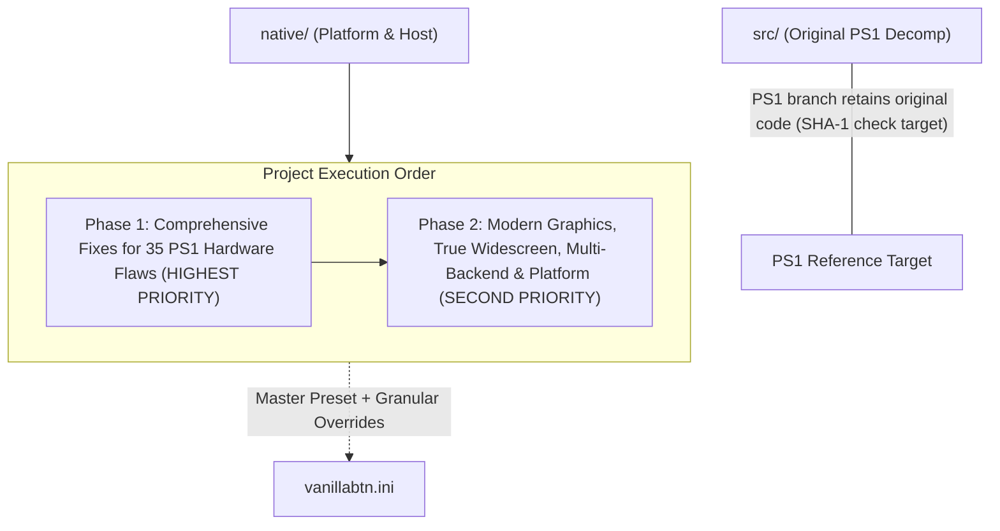

# Work 02: PS1 fixes and modern enhancements

## Status

Work 02 is the current major change in PR #3. Its implementation milestones are
complete and their known limitations are recorded here. Outstanding developer
acceptance is tracked in [TODO.md](../TODO.md). Code and synthetic checks do not
establish complete gameplay or audiovisual fidelity.

## Vision

Build on the as-is native baseline from [Work 01](01-porting.md), fixing PS1
hardware flaws and adding optional modern capabilities without weakening the
matching PS1 reference build. The priorities are:

1. **PHASE 1 (HIGHEST PRIORITY)**: Fix all 35 inherent hardware flaws, bottlenecks, and visual/audio artifacts of the original PlayStation 1 first (*PS1 Inherent Flaws & Bottlenecks Fixes*).
2. **PHASE 2 (SECOND PRIORITY)**: Implement modern graphics, widescreen, and platform capabilities (*Modern Hardware & Display Enhancements*).
3. **Master Preset Architecture**: Casual users are not burdened by dozens of individual settings. A single master preset (`mode = modern`) automatically activates all fixes and optimizations.

## Scope and boundaries



- **Protected Baseline Source**: Native-only compatibility conditionals in `src/` are compiled exclusively with `VANILLABTN_NATIVE`; the PS1 reference target retains its original behavior and SHA-1 checks.
- **Master Preset ("Best of Both Worlds")**: A single master switch `[Preset] mode = modern` resolves implemented fix toggles to their modern defaults. Granular toggles remain available with default `auto` values for advanced users seeking custom per-feature tuning.
- **Authoritative Simulation Pacing**: Game simulation (villager AI, clock/calendar, seasons, character movement speed, audio streaming) **remains strictly locked to real wall-clock time** (60 virtual vblanks/second). High-refresh-rate presentation never accelerates game time.

The configuration examples below document intended options as well as
implemented behavior. The host-only `render_scale` samples projected polygons
at higher integer resolutions; it does not change the authoritative PS1 VRAM.
See [TODO.md](../TODO.md) for outstanding developer acceptance.

## Architecture and approach

### Master preset system and `vanillabtn.ini`

Configuration module: `native/src/config.h` & `native/src/config.c`.
Current configuration lookup order (in `config_resolve_path`):
1. `vanillabtn.ini` in the **working directory**, if present.
2. `vanillabtn.ini` beside the executable (`SDL_GetBasePath()`), if present.
3. Otherwise create/use `vanillabtn.ini` in the working directory.

This is distinct from the memory-card default folder, which uses
`SDL_GetPrefPath()`. `--config` selects an explicit INI path.

#### Master preset behavior
- **`mode = modern`** (default): `auto` values use the modern defaults assigned by each feature's resolver.
- **`mode = authentic_ps1`**: `auto` feature toggles resolve to the authentic/default-off path where implemented.
- **`mode = custom`**: Explicit switches take precedence; unresolved `auto` entries still use the feature resolver's default rather than universally turning off.

#### Default `vanillabtn.ini`
```ini
; ==============================================================================
; VANILLABTN MASTER CONFIGURATION
; ==============================================================================

[Preset]
; Master preset mode: modern, authentic_ps1, custom
; - modern: implemented PS1 fix toggles use their modern defaults (Recommended!)
; - authentic_ps1: 100% authentic 1999 console experience (all fixes OFF)
; - custom: strictly follows individual switches below
mode = modern

[Display]
; Window mode: windowed, borderless, fullscreen, maximized
window_mode = windowed

; Active monitor index (0 = primary display, 1 = secondary, etc.)
monitor = 0

; Windowed resolution (default: 1280x960, 4x integer scale)
window_width = 1280
window_height = 960

; Fullscreen target resolution (0x0 = native desktop resolution of active monitor)
fullscreen_width = 0
fullscreen_height = 0
fullscreen_hz = 0

; Graphics backend: auto, vulkan, opengl, d3d11, d3d12, software
backend = auto

; V-Sync: on, off (on attempts adaptive first, then ordinary V-Sync)
vsync = on

; FPS Limiter: 30, 60, monitor (matches active monitor Hz), unlocked, or custom integer (e.g. 144)
fps_limit = monitor

; Widescreen: auto, off, on, stretch
; - auto: enables Hor+ when output aspect is wider than 4:3 by a small margin
; - off: authentic 4:3 pillarbox
; - on: TRUE WIDESCREEN (expands 3D horizontal FOV without stretching; 2D HUD remains centered)
; - stretch: anamorphic full-screen stretch
widescreen = auto

; Integer scaling: on, off
integer_scale = off

; Pixel Aspect Ratio: square (1:1), crt_ntsc (1.092 original NTSC CRT aspect ratio)
pixel_aspect_ratio = square

; ==============================================================================
; INDIVIDUAL SWITCHES (Leave as 'auto' to follow the master preset above)
; ==============================================================================

[PS1_Fixes]
; 1. Eliminate polygon wobbling (PGXP Subpixel Vertex Precision)
pgxp_vertex_precision = auto

; 2. Eliminate texture shearing/warping on terrain and roofs (PGXP Perspective-Correct Texturing)
pgxp_perspective_texture = auto

; 3. Eliminate polygon flickering & sunken shadows (True Float Z-Buffer + Shadow Bias)
true_depth_buffer = auto

; 4. Eliminate exploded polygon spikes near camera (Frustum W-Clipping)
near_plane_w_clipping = auto

; 5. Eliminate distortion on large terrain quads (Dynamic Quad Subdivision)
quad_subdivision = auto

; 6. Eliminate notched camera rotation (32-bit Float Trigonometry)
smooth_camera_angles = auto

; 7. Eliminate skeletal joint twitching (High-Precision Skeletal Math)
skeletal_precision = auto

; 8. Smooth curved animal & terrain surfaces (Smooth Phong Normals)
smooth_normals = auto

; 9. Eliminate color banding on skies and fog (True Color 32-bit ARGB8888)
true_color_32bit = auto

; 10. Eliminate checkerboard mesh noise (Dithering: off, native, deband)
dithering = auto

; 11. Eliminate 1-pixel seam lines at tile borders (Texture Bleeding Fix)
texture_bleeding_fix = auto

; 12. Eliminate dark halos around transparent sprites (Alpha Halo Fix)
alpha_halo_fix = auto

; 13. Eliminate crawling texture shimmering in the distance (Mipmapping & Trilinear Filter)
mipmapping = auto

; 14. Eliminate jagged polygon edges (Anti-Aliasing: off, msaa_4x, smaa)
anti_aliasing = auto

; 15. Eliminate concentric fog banding rings (Smooth Atmospheric Fog)
smooth_fog = auto

; 16. Eliminate water/smoke clipping through walls (Order-Independent Transparency)
oit_transparency = auto

; 17. Eliminate rain and festival lag (Fill-rate Overdraw Optimization)
zero_fillrate_lag = auto

; 18. Expand voice polyphony from 24 to 64 (Prevents BGM voice stealing by SFX)
expand_voice_polyphony = auto

; 19. Eliminate silence gap on BGM loop (Seamless CD-XA Loop)
seamless_cd_loop = auto

; 20. Eliminate click/pop on voice cutoff (Micro-Fade Audio Pop Fix)
audio_pop_suppression = auto

; 21. Eliminate micro-clicks in ambient audio loops (VAG Loop Crossfade)
vag_loop_crossfade = auto

; 22. 32-bit Float Audio Mixer (Prevents audio clipping distortion under heavy loads)
float_audio_mixing = auto

; 23. Eliminate metallic comb-filter reverb (High-Fidelity Reverb DSP)
hifi_reverb = auto

; 24. Eliminate walk slowdown during diagonal run (Circular Stick Normalization)
fix_diagonal_running = auto

; 25. Smooth modern rumble curve (HD Haptic Motor Curve)
hd_rumble = auto

[Graphics_Enhancements]
; Pixel-art texture filter: nearest (authentic), bilinear, xbrz
texture_filter = nearest

; Explicitly marked 2D background filter: nearest, bilinear, bicubic
; Background provenance comes from the original draw context, not image size.
background_filter = bicubic

; Optional host-only HD replacement pack. No original assets are overwritten.
texture_replacements = off
texture_pack = textures

; 3D software raster multiplier: 1..16 or native (match display height;
; automatically reduced when the memory safety limit is reached)
render_scale = 1

; Sharp high-resolution text: on, off
hd_font = auto

; Extended camera draw distance (view entire valley from Mother's Hill)
extended_draw_distance = auto

[Audio_Enhancements]
; SPU Voice Interpolation: gaussian (authentic PS1), linear, cubic (crisp)
spu_interpolation = auto

; Master Volume (0 - 100)
master_volume = 100

; Audio behavior on focus loss: on (mute when unfocused), off (continue playing)
mute_on_unfocus = off

[Input_QoL]
; Analog stick deadzone (0.00 - 0.50)
analog_deadzone = 0.10

; Pause policy switches: on, off (unfocus holds the VSync pump and sync clock)
pause_on_unfocus = off
pause_on_disconnect = on

; Turbo button (fast-forward cutscenes): Tab or none. F10 always toggles turbo;
; a gamepad button such as R2 is not wired.
turbo_hotkey = Tab
turbo_speed = 3.0
```

---

### Catalog of 35 PS1 hardware flaws addressed in Phase 1

#### Category A: Geometry, 3D mesh, and GTE unit

| No | Original PS1 Flaw | Manifestation in Harvest Moon: BTN | VanillaBTN Solution |
|---|---|---|---|
| **1** | **Screen Coordinate Integer Truncation** | Polygons of farmland, houses, and character models shake and jitter (*polygon wobble*) on subtle camera motion. | **PGXP Subpixel Vertex Precision**: Preserves 16-bit GTE fractional precision prior to integer quantization. |
| **2** | **Affine Texture Mapping (No Z-Divide)** | Pathways, ground terrain, and roofs stretch and shear along triangle diagonals (*texture warping*) at oblique angles. | **PGXP Perspective-Correct Texturing**: Full perspective-correct ($u/w, v/w, 1/w$) interpolation in rasterizer. |
| **3** | **No Hardware Z-Buffer (Coarse 12-bit OT)** | Polygons flicker and penetrate each other (*Z-fighting*). Character shadows partially sink into the soil. | **True 24/32-bit Float Z-Buffer** + *Shadow Polygon Depth Bias* ensuring shadows sit perfectly flush on terrain. |
| **4** | **Near-Plane Division-by-Zero Spiking** | When objects approach camera lens ($sz \to 0$), GTE quotient overflows, exploding polygons into massive screen-wide spikes. | **3D Near-Plane Frustum W-Clipping**: Clips geometry in camera space ($z > z_{\text{near}}$) prior to perspective division. |
| **5** | **Large Quad Distortion (No Subdivision)** | Large farmland and terrain quads suffer severe perspective and lighting distortion at centers. | **Dynamic Quad Subdivision / Tessellation**: Dynamically subdivides large quads for uniform lighting and texturing. |
| **6** | **12-bit CORDIC Trigonometric Quantization** | Cutscene camera panning and character rotations exhibit micro-stepping notches due to 4096-angle quantization. | **32-bit Floating-Point Continuous Trigonometry**: Silky-smooth camera panning with continuous angles. |
| **7** | **Fixed-Point Skeletal Hierarchy Math** | Rounding errors accumulate across bone transforms, causing character and animal joints to twitch (*joint popping*). | **High-Precision Skeletal Hierarchy Math**: Evaluates TMD bone matrix hierarchy using 32-bit floating point. |
| **8** | **Faceted Normals on Curved Surfaces** | Bodies of cows, sheep, dogs, and hills appear faceted like low-poly origami due to non-averaged face normals. | **Smooth Phong Normal Generation & Interpolation**: Produces smooth, organically curved animal and terrain surfaces. |
| **9** | **Harsh Gouraud Lighting Clamping** | Directional sunlight/lantern light on characters flips abruptly when rotating (*harsh lighting cutoff*). | **Smooth Normal Shading with Quadratic Falloff**: Natural, smooth lighting transitions without abrupt boundaries. |
| **10** | **Gouraud Quad-Split Kink** | Color gradients across quads split into distinct kinks along the shared diagonal seam. | **Perspective-Consistent Bilinear Quad Shading**: Smooth quad color interpolation without diagonal seams. |

---

#### Category B: Rasterizer, color, texture, and GPU

| No | Original PS1 Flaw | Manifestation in Harvest Moon: BTN | VanillaBTN Solution |
|---|---|---|---|
| **11** | **15-bit Color Depth (RGB555)** | Morning/sunset skies, nighttime scenes, fog, and dialogue boxes exhibit severe stepped lines (*color banding*). | **True Color 32-bit Pipeline (ARGB8888)**: Delivers 24-bit Gouraud shading and lighting directly without 15-bit reduction. |
| **12** | **4x4 Ordered Dithering Matrix** | Crosshatch mesh patterns (*checkerboard noise*) appear harsh on modern LCD/OLED monitors. | **Dithering Removal (`dithering = off / deband`)**: Completely eliminates checkerboard patterns with debanding options. |
| **13** | **Texture Bleeding at Tile Boundaries** | 1-pixel seam lines appear at tile edges during upscaling/filtering as samplers sample adjacent TPage sprites. | **Sub-Rectangle UV Clamping & Half-Texel Offset**: Enforces strict texture sub-rectangle clamping. |
| **14** | **1-Bit Transparency Alpha Halos** | Dark black outlines/fringing appear around foliage, character hair, and UI icons when filtered. | **Alpha-Premultiplied Sampling & Pre-Filter Alpha Testing**: Guarantees clean sprite edges without dark halos. |
| **15** | **Lack of Mipmapping** | Distant farmland, fences, and stones shimmer and crawl (*Moire patterns & texture crawling*). | **Automatic Mipmap Generation & Trilinear Filtering**: Renders calm, stable, shimmer-free distant terrain. |
| **16** | **Lack of Anti-Aliasing (Jaggies)** | Polygon silhouettes on roofs, characters, and trees have sharp stair-stepped jagged edges. | **MSAA (Multisample Anti-Aliasing) / SMAA**: Smooths 3D polygon silhouettes while preserving crisp 2D pixel art. |
| **17** | **Concentric Depth-Cueing Fog Rings** | Morning fog and winter blizzards appear as noticeable concentric circular bands following the camera. | **True Color 32-bit Atmospheric Exponential Fog**: Smooth volumetric mist covering the valley photorealistically. |
| **18** | **Transparent Object Sorting Inaccuracy** | Chimney/hot spring smoke and river water clip through solid structures unnaturally. | **Order-Independent Transparency (OIT) & Depth Peeling**: Renders water and smoke at accurate 3D spatial depths. |
| **19** | **Fill-Rate Overdraw Rain Lag** | PS1 drops to 15–20 FPS slow-motion during heavy rain or festivals due to GPU fill-rate exhaustion. | **Zero Fill-Rate Bottleneck Architecture**: Ensures smooth 60 FPS performance regardless of storm overdraw. |
| **20** | **2D Subpixel Coordinate Jitter** | Scrolling text dialogues, clock icons, and UI cursors snap 1 full pixel at a time. | **2D Subpixel Coordinate Rasterization**: Animates UI elements with subpixel smoothness. |
| **21** | **Harsh Additive Blend Color Blowout** | Lanterns or bright sunshine blow out highlights into clamped solid white patches. | **True Variable Alpha Blending & HDR Tonemapping**: Natural translucent illumination without white clipping. |
| **22** | **Mid-Frame CLUT Color Tearing** | Shimmering river water or fireplace glow flashes occasional palette artifacts during VRAM cycles. | **Double-Buffered Atomic Palette Updates**: Eliminates mid-frame palette desynchronization. |
| **23** | **480i Interlacing Shaking (Judder)** | High-res menus and credit sequences vibrate vertically (*bob deinterlacing judder*). | **True Progressive Scan**: Eliminates interlacing, rendering all lines progressively. |
| **24** | **NTSC CRT Non-Square Pixel Distortion** | On square-pixel PC monitors, raw 4:3 can appear slightly narrower than intended on NTSC CRTs (1.092 PAR). | **Configurable Pixel Aspect Ratio Correction (`par = square / crt_ntsc`)**. |

---

#### Category C: Audio SPU, CD-ROM, and sound engine

| No | Original PS1 Flaw | Manifestation in Harvest Moon: BTN | VanillaBTN Solution |
|---|---|---|---|
| **25** | **24-Voice Polyphony Limit (Voice Stealing)** | Heavy rain + BGM + livestock + footsteps + tools causes music instruments to abruptly mute (*cut-off*). | **Expanded Polyphony (64 Virtual Voices)**: Sound effects never steal background music instruments. |
| **26** | **CD-XA Looping Silence Gap** | BGM tracks pause for 0.5–1.0s on loop repeat while the physical optical laser seeks back to the start. | **Seamless Zero-Gap CD-XA Looping**: Instant circular buffer looping with zero silence gap. |
| **27** | **Voice Key-Off Pop / Click Noise** | Audible clicks occur when voices or sound effects terminate abruptly at non-zero amplitudes. | **Micro-Fade Envelope**: Applies 1–2 ms smooth ramp to zero on abrupt key-offs, silencing pops. |
| **28** | **VAG ADPCM Block Boundary Loop Click** | Ambient audio loops (river stream, crickets, rain) click micro-periodically at 28-sample block boundaries. | **Sample-Exact Zero-Crossing Crossfade Smoothing**: Seamless, click-free ambient audio loops. |
| **29** | **16-bit Integer Mixing Headroom Clipping** | Distorted crackling (*audio clipping*) occurs when multiple loud sounds play concurrently. | **32-bit Floating-Point Audio Mixing**: Unlimited dynamic headroom with distortion-free audio. |
| **30** | **Metallic Reverb Boxiness (22 kHz Downsample)** | Indoor, mine, or church reverb sounds boxy and metallic due to 16-bit 22.05 kHz delay buffers. | **High-Fidelity 44.1/48 kHz 32-bit Float Reverb DSP**: Natural, warm, spacious room acoustics. |
| **31** | **Muffled High-Frequencies (Analog Filter)** | PS1 analog output circuitry sharply attenuates frequencies above ~15 kHz, muffling cymbals and birds. | **Full-Spectrum Audio Output (20 Hz – 20,000 Hz)** without artificial high-frequency roll-off. |
| **32** | **Equal-Power Panning Law Overflow** | Hard-panned sounds jump in volume at extreme stereo edges, clipping DAC registers. | **-3dB Equal-Power Stereo Panning**: Smooth, balanced stereo imaging without volume spikes. |

---

#### Category D: Input, controllers, and platform

| No | Original PS1 Flaw | Manifestation in Harvest Moon: BTN | VanillaBTN Solution |
|---|---|---|---|
| **33** | **Octagonal Analog Gate Asymmetry** | Pushing thumbsticks diagonally often drops below the run threshold, causing Jack to walk unexpectedly. | **Circular Stick Normalization & Diagonal Overdrive**: Full 100% running speed in all 360 degrees. |
| **34** | **1-Bit Binary Small Rumble Motor** | Small rumble motor is binary (0% or 100% abrupt buzz), jarring hands when fishing or hammering. | **HD Haptic & Continuous Motor Curve Mapping**: Proportional analog haptic curves for Xbox and DualSense. |
| **35** | **Sub-Frame Input Polling Lag & Disconnect Freeze** | Input lag up to 33 ms from VBlank-only polling; game freezes if controller disconnects. | **Sub-Millisecond Raw Input Polling (<1 ms latency)** + **Auto-Pause on Controller Disconnect**. |

---

### Modern graphics and platform features in Phase 2

Alongside the Phase 1 fix implementations, Phase 2 adds modern platform capabilities:

1. **True Widescreen (Hor+ 3D FOV Expansion)**:
   - Expands horizontal 3D camera FOV in GTE proportionally to display aspect ratio ($1.333\times$ for 16:9, $1.75\times$ for 21:9 ultrawide), revealing more of the farm and town without stretching.
   - Extends native culling bands so objects at widescreen boundaries do not prematurely pop out.
   - Anchors 2D HUD, dialogue boxes, stamina, clock, sprites, tiles, lines, and screen-space polygons within a centered 4:3 safe area without distortion; sprite UVs are resampled across the compressed destination width.
   - Resolves the output aspect before the first game frame and refreshes it on presentation, keeping GTE projection, native culling, and 2D safe-area transforms synchronized. Explicit stretch mode remains available for intentional anamorphic output; forced Hor+ on displays narrower than 4:3 falls back to aspect-preserving letterboxing.
2. **Multi-Backend Graphics (`Ps1HostRenderer`)**:
   - Automatic fallback chain: `Vulkan` $\rightarrow$ `Direct3D 11` $\rightarrow$ `OpenGL` $\rightarrow$ `Software (CPU)`.
3. **Multi-Monitor & 4 Window Modes**:
   - Active monitor enumeration (`monitor = 0, 1...`) via `SDL_GetDisplays()`.
   - Automatic logging of supported resolutions and refresh rates (Hz) on startup.
   - 4 window modes: `windowed`, `borderless`, `fullscreen`, and `maximized`.
4. **Decoupled FPS Limiter (Authoritative Pacing)**:
   - Simulation locked to **60 virtual vblanks / 30 game ticks per real second**.
   - Presentation loop free to run at `30`, `60`, monitor Hz (e.g. `144 Hz`), or `unlocked` without speeding up gameplay.
5. **Quality of Life & HD Font**:
   - HD Signed Distance Field (SDF) text rendering for razor-sharp dialogues at 4K.
   - Extended camera draw distance (`extended_draw_distance`) to view the entire valley from Mother's Hill.
   - Optional Turbo hotkey to fast-forward lengthy cutscenes.
   - Auto-backup memory card snapshots on save.

---

## Work plan

### Phase 1: Configuration foundation and PS1 flaw fixes — implementation complete
- [x] **Milestone 1**: `vanillabtn.ini` configuration subsystem (`config.c/h`) with Master Preset System (`mode = modern / authentic_ps1 / custom`).
- [x] **Milestone 2**: PGXP Precision Pipeline — GTE subpixel float vertex precision (anti-wobble) and perspective-correct texturing (anti-warp).
- [x] **Milestone 3**: True Depth Buffer & Shadow Bias — Eliminates polygon Z-fighting and sunken character shadows.
- [x] **Milestone 4**: Near-Plane Frustum W-Clipping & Quad Tessellation — Eliminates near-camera polygon explosions and large quad distortion.
- [x] **Milestone 5**: 32-bit Float GTE Math — Smooth camera panning without notches and skeletal joint twitching fix.
- [x] **Milestone 6**: True Color 32-bit & Dithering Removal — Eliminates sky/fog color banding and checkerboard noise.
- [x] **Milestone 7**: Texture Bleeding, Alpha Halo, & Mipmapping Fix — Eliminates 1-pixel tile seams, sprite dark halos, and distant texture crawling.
- [x] **Milestone 8**: Anti-Aliasing (MSAA/SMAA) & Smooth Atmospheric Fog — Smooths polygon edges and eliminates concentric fog rings.
- [x] **Milestone 9**: Audio Subsystem Overhaul — Expanded 64-voice polyphony, seamless CD-XA looping, micro-fade pop suppression, VAG loop crossfading, and 32-bit float mixing.
- [x] **Milestone 10**: Hi-Fi Reverb & Full-Spectrum Audio — Eliminates metallic comb filtering and high-frequency roll-off.
- [x] **Milestone 11**: Zero Fill-rate Bottleneck Architecture — Removes the emulated PS1 fill-rate bottleneck from heavy overdraw.
- [x] **Milestone 12**: Input Subsystem Fixes — Circular analog normalization (diagonal running fix), HD rumble curve, sub-frame raw input polling, and disconnect auto-pause.

### Phase 2: Modern graphics and platform enhancements — implementation complete with limits
- [x] **Milestone 13**: Multi-Monitor Discovery & 4 Window Modes (`host_display.c/h`).
- [x] **Milestone 14**: Decoupled FPS Limiter & Pacing Lock (`host_pacing.c/h`, `sdk_sync.c/h`).
- [x] **Milestone 15**: True Widescreen Hor+ 3D FOV Expansion (`ps1_gte.c/h`, `host_display.c/h`).
- [x] **Milestone 16**: Multi-Backend Renderer Abstraction (`host_renderer.c/h`).
- [x] **Milestone 17**: HD Font & QoL Features (`ps1_card.c/h`, `ps1_video.c/h`, `sdk_sync.c/h`).

### Completed follow-up milestones

These milestones extended and hardened the two planned phases. Their detailed
behavior and limitations are retained in the implementation notes below.

| Milestone | Completed implementation |
| --- | --- |
| **18** | Hold the VSync loop on primary-controller disconnect without clock catch-up. |
| **19** | Add optional NTSC CRT pixel-aspect correction at presentation. |
| **20** | Persist intentional virtual memory-card unformat operations and backup rotation. |
| **21** | Rasterize projected 3D polygons into a scalable host-only surface. |
| **22** | Present the selected `render_scale` without changing logical game or HUD coordinates. |
| **29** | Upscale sprites, UI and projected pixel-art textures in the host sidecar with a bounded clean-room xBRZ-compatible cache; filter explicitly marked backgrounds separately and support optional content-hash HD replacements. |
| **23** | Extend farm-world horizontal visibility gates for Hor+ presentation. |
| **24** | Add optional full-rate stereo Hi-Fi reverb while retaining the authentic path. |
| **25** | Bound native dynamic text-insert source lookups. |
| **26** | Make native empty-label rendering and measurement safe. |
| **27** | Add native Debug crash reports that are absent from Release. |
| **28** | Copy native villager animation state using host structure sizes. |
| **29** | Clear complete native chicken records before slot reuse. |
| **30** | Clear complete native farm-action records before slot reuse. |
| **31** | Add Debug-only audio transport diagnostics. |
| **32** | Cover dry SPU output under authentic and Hi-Fi reverb settings. |
| **33** | Handle empty native `.ANI` part lists without forming invalid pointers. |
| **34** | Isolate Windows Debug audio-report declarations from PS1 SDK types. |
| **35** | Reserve bounded SDL queue headroom when music first becomes audible. |
| **36** | Add optimized Debug stall tracing while excluding diagnostics from Release. |
| **37** | Pace native PCM generation from elapsed output sample time. |
| **38** | Bound SDL catch-up submissions to a four-tick queue. |
| **39** | Skip native photo-map actor markers for locations without map spots. |
| **40** | Add a persistent Debug logger console and optimize symbol-rich Debug builds for CPU-heavy native emulation. |
| **41** | Preserve near-integer 16:9 presentation at 1280×720 and distribute native weather particles across Hor+ margins. |
| **42** | Rebase turbo timing at runtime, dispatch every accelerated VBlank consistently, and mute accelerated audio output. |

## Verification

Milestone labels mean implementation and synthetic tests exist, not that every
option has undergone hands-on gameplay acceptance. Remaining acceptance tasks
are listed in `TODO.md`; renderer backend selection falls back through the chain
above, and the developer has confirmed the HD font and extended draw distance on
Windows. Turbo works. Its audio is not heard accelerating, because the bounded SDL
queue drops PCM beyond four ticks; the developer chose to leave this as is.

## Implementation notes

This section describes implementation details and compatibility boundaries of
optional native enhancements. The original game remains authoritative for
scenes, assets, events, timing, and save semantics. Keep native compatibility
changes separate from the matching PS1 reference build.

### Dynamic presentation and true Hor+ widescreen

- `native/src/host_display.c` derives the effective horizontal aspect from
  the active SDL renderer output. `widescreen = auto` selects Hor+ for output
  wider than 4:3; `off` retains 4:3 letterboxing; `stretch` is an explicit
  anamorphic presentation mode. Resizing the window updates the presentation.
- The native software rasterizer retains the original PS1 VRAM layout, texture
  pages, and CLUT. `native/src/ps1_video.c` allocates a *separate panoramic
  sidecar* for columns outside the original 320-pixel display area; it does not
  write widescreen pixels into texture VRAM. The dynamically calculated logical
  canvas widens horizontally, while its normal PS1 height remains 240 rows.
- GTE-projected geometry can be rasterized into the extension without changing
  original world positions. Native frustum/culling adjustments are guarded by
  `VANILLABTN_NATIVE`. The farm's `estate_point_on_screen` keeps its existing
  vertical rejection band but widens horizontal visibility to include the Hor+
  margins for farm actors, objects and weather. Native rain, storm, snow and
  blizzard particles also use those margins when choosing their horizontal
  spawn range; their count and random-call cadence remain unchanged. Other
  scene-specific culling still requires hands-on checks on ultrawide displays.
  Ordinary screen-space HUD and UI primitives stay in the original centered
  4:3 area.
- Integer scaling remains strict unless the rounded Hor+ canvas misses an exact
  output multiple by at most one scale factor. In particular, 427×240 at 3×
  needs 1281×720; a 1280×720 output tolerates that rounding pixel instead of
  falling back to 2× with a large black border.
- PS1 draw and display environments use **two distinct frame pages**, at VRAM
  rows 0–239 and 240–479. The sidecar preserves each page until actual clear,
  fill, or draw operations change its pixels. Beginning another ordering table
  must not implicitly erase the page currently displayed.
- The optional high-resolution host surface holds independent samples of
  GTE-projected polygons at integer multiples of the PS1 raster size. Original
  320×240 VRAM writes continue unchanged for texture reads and save/display
  semantics; 2D UI and sprite commands composite into the corresponding host
  sample blocks at their original positions. Off-screen panorama columns and
  both framebuffer pages are kept separate. No supersampling occurs at 1x.
  This is a software rasterizer and is not a claim of GPU-native 4K rendering.

### World primitives, screen overlays, and authored backgrounds

- PGXP provenance identifies projected 3D primitives; the SDK adapter also
  recognizes world packets from the depth ordering table, including sprites
  whose screen coordinates were calculated by the game instead of emitted
  directly by GTE. UI ordering tables do not automatically gain world clipping.
- Explicitly marked 2D backgrounds may extend into panorama margins. The
  classification is attached to queued GP0 packets so it cannot leak across
  frames or be guessed from a later global draw state. Polygon, sprite, tile,
  and line paths preserve their normal depth, texture, mask, and blend rules.
- Repeated 24-pixel menu backgrounds (Load/Save and Toolbox) use their actual
  four-tile **96-pixel** period. Repeated copies affect only sidecar columns;
  they must not redraw the original central 4:3 frame or duplicate UI.
- The title's scrolling background is already authored as tiled sprite fields.
  Its OT backdrop layers are allowed to reach the margins, but already-tiled
  title sprites must **not** receive extra shifted copies: double-drawing
  semitransparent sprites changes their color. Logo/UI layers remain separate.
- Map-like pages with a plain white canvas can extend that background without
  repeating map artwork. An uncovered side area must not be filled by mirrored
  or scanline-smeared copies of the central image; only actual background/world
  drawing or an intentional neutral canvas belongs there.

### Scene transitions and framebuffer fidelity

- Explicit `ClearImage` and GP0 fill operations update the corresponding
  panoramic page. Fullscreen fade quads/tiles apply the same ordering, blending,
  and mask behavior to both the original display and its side margins.
- Original stepped fades temporarily select a 640×480 PS1 display mode. For
  that specific transition, the host preserves the last valid panoramic
  320×240 display page and its Hor+ presentation; the fullscreen fade is
  composited across the panorama rather than snapping the window to a 4:3
  logical canvas. This is **not** a general widescreen extension for arbitrary
  640×480 artwork or display modes.
- PGXP shared-edge rasterization computes edge deltas in double precision,
  avoiding float-first rounding disagreement between adjacent polygons.
  Quad vertex provenance is kept consistent through clipping/subdivision.

### SPU envelope and reverb compatibility

- The authentic SPU reverb clock continues to alternate left/right at 22.05 kHz,
  apply the 39-tap half-band FIR, and use the original reverb RAM tap layout.
  Its clock and envelope rates are not changed by high-resolution graphics.
- With `hifi_reverb = on`, both reverb channels are stepped on every 44.1 kHz
  output sample using the configured reverb RAM and effect registers, without
  the authentic half-rate FIR. Only the wet reverb path is affected; normal
  ADSR attack/decay/sustain/release clocks still advance once per SPU sample.
  Toggling this mode changes the reverb's character and is not a claim of
  PlayStation hardware equivalence. Authentic mode and game audio pacing stay
  available; objective hardware traces and listening checks remain necessary
  for a fidelity claim.

### Native SDL music-onset buffering

- At a regular 60 Hz callback, the native game produces 735 stereo PCM frames.
  The native host now tracks elapsed time at the 44.1 kHz sample rate so a
  delayed/skipped VSync does not permanently omit PCM; catch-up is limited
  to four ticks per callback and suspended time is excluded. Turbo continues
  to advance the SPU and music sequencer once per accelerated simulation tick,
  but does not submit the pitch-shifted PCM to SDL. Entering or leaving turbo
  clears queued output, so normal-pitch audio resumes without stale samples.
  This only changes native PCM delivery; it does not rewrite the original game
  audio state or PS1 build.
- At the first nonzero output of a newly playing music sequence, the SDL
  stream gets up to two ticks of silent headroom before the real samples.
  This one-time reserve can absorb a brief loading stall around the title
  music's initial playback; it does not generate extra game/SPU samples,
  alter voice state, or keep growing latency on subsequent ticks. The
  SDL queue budgeting now includes that initial reserve before admitting the
  generated PCM. If a delayed callback generates more samples than will fit,
  only the newest PCM frames are submitted, while the original SPU is still
  mixed for the full elapsed time. This limits queued host latency to four
  ticks instead of permitting a catch-up packet to overflow the previous
  eight-tick gate. The previously reported title playback dropouts are no
  longer observed with the bounded queue. A blocked game thread could still
  cause future underruns; that remains a separate issue if reproduced.

### Optional native title-stall timing

- `--trace-stalls` enables a low-overhead timer only in native Debug. The
  Debug and compatibility `DebugOptimized` presets use `/O2 /Zo` with symbols,
  making the CPU-heavy software renderer practical to investigate. Release
  compiles out all tracing and does not accept this flag.
  It retains only the most recent 128 outliers longer than 33.3 ms, including
  game work between VSync calls, host waits, SDL events, input, audio mixing
  and frame presentation. Each record includes numeric scene/entry, effective
  render scale and sampled SDL audio queue depth. No music, save or disc bytes
  are captured. The periodic Debug audio-status report is suppressed while
  this probe is active, to avoid introducing artificial two-second file I/O
  stalls. No file is written during gameplay: on a normal exit, the
  trace is saved as `VanillaBTN-stalls.txt` in the working directory.
- A stall trace can expose long event dispatch or VSync gaps, but the SDL
  queued-byte reading is not a reliable measurement of samples already held
  by the playback device. The native PCM sample-clock correction therefore
  does not use queue depth to accelerate the mixer or grow a buffer. Very long
  blocked host callbacks may still cause output underruns and require a
  separate investigation if reproduced after the pacing correction.

### Native Debug failure diagnostics

- The native Debug game installs a Windows exception/abort handler and connects
  the original `SystemError` abort path to a diagnostic hook. It records only
  call-stack names/relative offsets, exception codes and numeric game/menu
  state, in a temporary text file, without storing asset bytes or saves.
  The Release binary does not link the handler or DbgHelp.
- Debug starts a separate console process and streams timestamped host lifecycle,
  renderer, graphics, audio, input, save, timing and original-game error events
  through a named pipe. If the game crashes, Windows closes the game side of the
  pipe while the console remains open for inspection. Logging is limited to
  state transitions and failures rather than hot raster or mixer loops.
- Debug compiles with `/O2 /Zo` and PDB symbols. The native software rasterizer,
  GTE compatibility code and audio mixer were prohibitively slow under MSVC's
  default `/Od`; optimized debugging retains diagnostics while making runtime
  investigation practical. Release still compiles all developer logging out.
- The developer confirmed the separate game and logger windows work as expected
  and that the logger remains available after forcibly ending the game process.
- The developer confirmed the 1280×720 integer-scale fallback and Hor+ weather
  coverage fixes in a real game window.
- The developer confirmed turbo uses one consistent accelerated cadence across
  the farm, Popuri's area, church, interiors, events and transitions; original
  clock-stop rules remain intact, and muted audio resumes cleanly afterward.
- This exposes failures that synthetic text/menu fixtures cannot reproduce.
  A Windows Debug report localized the NPC conversation failure to a
  low-address read in `sprite_draw_frame`; this diagnostic alone cannot prove
  which earlier state transition damaged the animation pointer.

- Native farm event entry now copies each villager's complete `AnimState`
  from `sprite80` to `sprite` by typed record access. The reference routine
  assumes 48-byte animation states and 0x1D4-byte villager records; these
  offsets do not hold when host pointers are 64-bit. The native path preserves
  animation table pointers across the event transition while leaving the PS1
  byte-matching routine unchanged. The developer retested the original NPC
  conversation on Windows and confirmed that the crash is fixed.

- The native farm photo map now omits the player or dog marker if the
  corresponding place ID is absent from its map lookup table. The lookup uses
  `-1` for unknown places; previously both actor markers indexed the position
  table with that value. Valid map spots and the original PS1 path are unchanged.
  Actual photo-map navigation still needs native gameplay validation.

### Configuration and host lifecycle

- `native/src/config.c` preserves custom numeric FPS limits and the literal
  `render_scale = native` setting through INI save/reload. Malformed sections,
  nonfinite numbers, integer overflow, and truncated paths are rejected
  instead of silently changing another setting.
- `render_scale = 1..16` controls the integer multiplier of a host-only
  software raster target for projected 3D geometry and filtered textured
  primitives. `render_scale = native`
  picks the ceiling of SDL output height divided by 240 (up to 16).
  The allocator reduces the multiplier as needed to stay below 12 million
  samples across 512 PS1 framebuffer rows, and uses the 1x path on failure.
  Presentation uses the resulting higher-resolution SDL streaming texture
  inside the **same** logical 4:3/panoramic canvas; HUD, pixel-aspect correction,
  framebuffer texture coordinates and PS1 VRAM are not rescaled. This is
  integer software supersampling, not necessarily one sample per physical
  monitor pixel, and requires visual/performance validation in the game.
- `texture_filter = xbrz` now selects an independently written scale-by-rules
  implementation for sprites, UI and projected pixel-art texture regions in
  the high-resolution host sidecar. Factors 2 through 6 are cached by decoded
  content; higher host scales reuse the 6x result. The upstream GPLv3 xBRZ
  source is neither copied nor linked into this MIT project. Nearest remains
  available, and the `authentic_ps1` preset forces nearest presentation.
- Explicit background provenance already carried by the ordering-table bridge
  selects `background_filter` instead of xBRZ. `bilinear` and `bicubic` smooth
  authored 2D backdrops; `nearest` is available for a pixel-authentic result.
  Primitive dimensions are deliberately not used to guess whether artwork is
  a background.
- `texture_replacements = on` enables an optional host-only BMP pack under the
  relative `texture_pack` directory. Files use
  `<content-key>_<source-width>x<source-height>.bmp`, where `content-key` is the
  lowercase 16-digit FNV-1a key produced from the little-endian width, height
  and decoded ARGB8888 rows. Images must be an integral 1x..16x enlargement in
  both dimensions. Invalid or missing files fall back to the selected filter;
  misses are cached so the renderer does not probe the filesystem each frame.
  Lookup also tries the same relative directory beside the executable.
  Replacements and scaled pixels share a bounded 64 MiB LRU cache.
- `pixel_aspect_ratio = crt_ntsc` applies the NTSC CRT 1.092 horizontal pixel
  aspect at SDL presentation, without changing VRAM resolution, HUD placement,
  game coordinates or polygon projection. Hor+ FOV is calculated from the
  corrected physical output aspect so the HUD stays in its original centered
  safe area. `widescreen = stretch` remains an explicit anamorphic override.
- `pause_on_unfocus = on` holds the original loop inside the VSync pump while
  the window is unfocused and clears queued audio. `sdk_sync_suspend` and
  `sdk_sync_resume` remove the held time from the VSync epoch, so the loop does
  not catch up afterwards. The synthetic `sdk_vsync_timing` test covers the
  clock. The developer confirmed in a real window that the game freezes and
  resumes without fast-forwarding; audio silence while paused was not reported.
  `pause_on_disconnect` now shares the VSync hold: removing the primary controller
  suspends simulation until reconnection; if unfocused, the focus hold remains active.
- Frame pacing uses overflow-safe elapsed-time calculations. Adaptive V-Sync
  falls back to standard V-Sync when available. SDL window-mode failures are
  propagated, and toggle hotkeys ignore repeated key-down events.
- Native output-side master volume and focus mute do not rewrite the game's
  underlying PS1 mixer state. Nonfinite analog deadzones are sanitized before
  float-to-integer conversion.

### Dialogue and shared text safety

- Native text-insert expansion now checks the 12-slot dynamic-source table
  before resolving unknown or absent script inserts. The renderer, line
  counter, entry counter, and text measurement use the same bounded fallback;
  scripted names and other known inserts retain their existing behavior.
  This removes an out-of-range memory access shared by dialogue, menus, and
  event text, but does not establish the cause of any particular gameplay crash
  without a reproducing trace. The PS1 reference lookup is unchanged.
- Empty optional labels no longer read the preceding halfword while drawing
  or measuring text; the native path also avoids checking the previous glyph
  when the cursor is at index zero. The reference PS1 code is unaffected.

### Virtual memory-card reliability

- Card writes preserve the prior image on failure. Backups rotate through
  `.bak` and `.bak.1`–`.bak.5`, and interrupted writes can be recovered from
  `.bak.hold` and `.tmp` as appropriate. Recovery also searches older valid
  backup generations instead of initializing a blank card while unresolved
  candidates remain.
- Explicit card directories must exist and be directories. Empty filenames,
  truncated paths, invalid allocation chains, and short 128 KiB card-image
  reads fail safely. Block-chain lookups validate once and still bounds-check
  the indices used by subsequent reads.
- Memory-card test fixtures allocate their large card-manager objects on the
  heap instead of the limited Windows executable stack. This change is
  test-only and does not alter the production save format.
- The original card utility's `MemCardUnformat` now invalidates only the raw
  card signature and persists the result through the same staged write and
  backup rotation as formatting. Existing file bytes remain on disk and the
  last formatted image remains in `.bak` (and later backup generations).
  An intentional unformat is recognized by verifying the original card would
  be structurally valid with its signature restored. Recovery does not
  silently format it or restore an older backup; damaged images without this
  proof are still rejected. Explicit `MemCardFormat` starts a fresh card.

### Compatibility limits

- `src/` remains the original game source and should not be modified for
  cosmetic widescreen presentation. Native compatibility code belongs in
  the adapter/host layer whenever possible; if a native-only source branch is
  unavoidable, keep the PS1 reference path intact.
- Asset loading still uses original PS1 game data supplied by the user; no
  proprietary disc files or SDK content belong in the repository.
- Higher-resolution polygon and filtered-texture rasterization uses separate host-only integer
  supersamples; an output-limited software rasterizer cannot guarantee
  exact physical-resolution samples at every display size or refresh rate.
  xBRZ reconstructs pixel-art edges and HD packs can supply replacement detail,
  but neither method changes the original texture or framebuffer words in VRAM.
- For outstanding developer acceptance, use [TODO.md](../TODO.md); for build
  instructions, use [building.md](building.md); for the SDK compatibility
  boundary, use [native-sdk.md](native-sdk.md).
