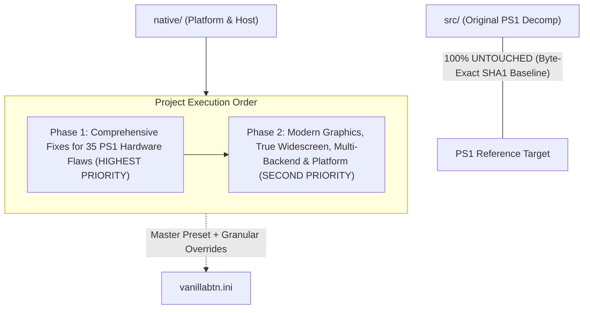

# VanillaBTN: Enhancement & Modernization Master Blueprint

This document defines the comprehensive master architectural blueprint for VanillaBTN's **Enhancement & Modernization** phase. Based on core project priorities:
1. **PHASE 1 (HIGHEST PRIORITY)**: Fix all 35 inherent hardware flaws, bottlenecks, and visual/audio artifacts of the original PlayStation 1 first (*PS1 Inherent Flaws & Bottlenecks Fixes*).
2. **PHASE 2 (SECOND PRIORITY)**: Implement modern graphics, widescreen, and platform capabilities (*Modern Hardware & Display Enhancements*).
3. **Master Preset Architecture**: Casual users are not burdened by dozens of individual settings. A single master preset (`mode = modern`) automatically activates all fixes and optimizations.

---

## 1. Core Principles & System Boundaries



- **Protected Baseline Source**: Native-only compatibility conditionals in `src/` are compiled exclusively with `VANILLABTN_NATIVE`; the PS1 reference target retains its original behavior and SHA-1 checks.
- **Master Preset ("Best of Both Worlds")**: A single master switch `[Preset] mode = modern` enables all 35 fixes automatically. Granular toggles remain available with default `auto` values for advanced users seeking custom per-feature tuning.
- **Authoritative Simulation Pacing**: Game simulation (villager AI, clock/calendar, seasons, character movement speed, audio streaming) **remains strictly locked to real wall-clock time** (60 virtual vblanks/second). High-refresh-rate presentation never accelerates game time.

---

## 2. Master Preset System & `vanillabtn.ini` Specification

Configuration module: `native/src/config.h` & `native/src/config.c`.
Search order:
1. Beside the executable (`./vanillabtn.ini`).
2. User preferences directory (`SDL_GetPrefPath("VanillaBTN", "VanillaBTN")`).

### Master Preset Behavior:
- **`mode = modern`** (Recommended Default): All settings configured as `auto` automatically resolve to **`on` / optimal**, instantly eliminating PS1 hardware flaws without manual configuration.
- **`mode = authentic_ps1`**: All settings configured as `auto` resolve to **`off` / native**, preserving 100% authentic 1999 console behavior for retro purists.
- **`mode = custom`**: Bypasses presets and strictly follows individual toggle values.

### Default `vanillabtn.ini`:
```ini
; ==============================================================================
; VANILLABTN MASTER CONFIGURATION
; ==============================================================================

[Preset]
; Master preset mode: modern, authentic_ps1, custom
; - modern: ALL 35 PS1 flaw fixes are automatically enabled (Recommended!)
; - authentic_ps1: 100% authentic 1999 console experience (all fixes OFF)
; - custom: strictly follows individual switches below
mode = modern

[Display]
; Window mode: windowed, borderless, fullscreen, maximized
window_mode = windowed

; Active monitor index (0 = primary display, 1 = secondary, etc.)
monitor = 0

; Windowed resolution (default: 1280x960, 4x integer scale)
window_width = 1280
window_height = 960

; Fullscreen target resolution (0x0 = native desktop resolution of active monitor)
fullscreen_width = 0
fullscreen_height = 0
fullscreen_hz = 0

; Graphics backend: auto, vulkan, opengl, d3d11, d3d12, software
backend = auto

; V-Sync: on, off, adaptive
vsync = on

; FPS Limiter: 30, 60, monitor (matches active monitor Hz), unlocked, or custom integer (e.g. 144)
fps_limit = monitor

; Widescreen: auto, off, on, stretch
; - auto: automatically enables if aspect ratio >= 1.55 (16:9, 16:10, 21:9)
; - off: authentic 4:3 pillarbox
; - on: TRUE WIDESCREEN (expands 3D horizontal FOV without stretching; 2D HUD remains centered)
; - stretch: anamorphic full-screen stretch
widescreen = auto

; Integer scaling: on, off
integer_scale = off

; Pixel Aspect Ratio: square (1:1), crt_ntsc (1.092 original NTSC CRT aspect ratio)
pixel_aspect_ratio = square

; ==============================================================================
; INDIVIDUAL SWITCHES (Leave as 'auto' to follow the master preset above)
; ==============================================================================

[PS1_Fixes]
; 1. Eliminate polygon wobbling (PGXP Subpixel Vertex Precision)
pgxp_vertex_precision = auto

; 2. Eliminate texture shearing/warping on terrain and roofs (PGXP Perspective-Correct Texturing)
pgxp_perspective_texture = auto

; 3. Eliminate polygon flickering & sunken shadows (True Float Z-Buffer + Shadow Bias)
true_depth_buffer = auto

; 4. Eliminate exploded polygon spikes near camera (Frustum W-Clipping)
near_plane_w_clipping = auto

; 5. Eliminate distortion on large terrain quads (Dynamic Quad Subdivision)
quad_subdivision = auto

; 6. Eliminate notched camera rotation (32-bit Float Trigonometry)
smooth_camera_angles = auto

; 7. Eliminate skeletal joint twitching (High-Precision Skeletal Math)
skeletal_precision = auto

; 8. Smooth curved animal & terrain surfaces (Smooth Phong Normals)
smooth_normals = auto

; 9. Eliminate color banding on skies and fog (True Color 32-bit ARGB8888)
true_color_32bit = auto

; 10. Eliminate checkerboard mesh noise (Dithering: off, native, deband)
dithering = auto

; 11. Eliminate 1-pixel seam lines at tile borders (Texture Bleeding Fix)
texture_bleeding_fix = auto

; 12. Eliminate dark halos around transparent sprites (Alpha Halo Fix)
alpha_halo_fix = auto

; 13. Eliminate crawling texture shimmering in the distance (Mipmapping & Trilinear Filter)
mipmapping = auto

; 14. Eliminate jagged polygon edges (Anti-Aliasing: off, msaa_4x, smaa)
anti_aliasing = auto

; 15. Eliminate concentric fog banding rings (Smooth Atmospheric Fog)
smooth_fog = auto

; 16. Eliminate water/smoke clipping through walls (Order-Independent Transparency)
oit_transparency = auto

; 17. Eliminate rain and festival lag (Fill-rate Overdraw Optimization)
zero_fillrate_lag = auto

; 18. Expand voice polyphony from 24 to 64 (Prevents BGM voice stealing by SFX)
expand_voice_polyphony = auto

; 19. Eliminate silence gap on BGM loop (Seamless CD-XA Loop)
seamless_cd_loop = auto

; 20. Eliminate click/pop on voice cutoff (Micro-Fade Audio Pop Fix)
audio_pop_suppression = auto

; 21. Eliminate micro-clicks in ambient audio loops (VAG Loop Crossfade)
vag_loop_crossfade = auto

; 22. 32-bit Float Audio Mixer (Prevents audio clipping distortion under heavy loads)
float_audio_mixing = auto

; 23. Eliminate metallic comb-filter reverb (High-Fidelity Reverb DSP)
hifi_reverb = auto

; 24. Eliminate walk slowdown during diagonal run (Circular Stick Normalization)
fix_diagonal_running = auto

; 25. Smooth modern rumble curve (HD Haptic Motor Curve)
hd_rumble = auto

[Graphics_Enhancements]
; Texture filter: nearest (sharp pixel art), bilinear (smooth), xbrz
texture_filter = nearest

; Internal render resolution multiplier: 1, 2, 4, 8, native
render_scale = 1

; Sharp high-resolution text: on, off
hd_font = auto

; Extended camera draw distance (view entire valley from Mother's Hill)
extended_draw_distance = auto

[Audio_Enhancements]
; SPU Voice Interpolation: gaussian (authentic PS1), linear, cubic (crisp)
spu_interpolation = auto

; Master Volume (0 - 100)
master_volume = 100

; Audio behavior on focus loss: on (mute when unfocused), off (continue playing)
mute_on_unfocus = off

[Input_QoL]
; Analog stick deadzone (0.00 - 0.50)
analog_deadzone = 0.10

; Pause when window is unfocused / controller disconnected: on, off
pause_on_unfocus = off
pause_on_disconnect = on

; Turbo button (fast-forward cutscenes): Tab, R2, or none
turbo_hotkey = Tab
turbo_speed = 3.0
```

---

## 3. Comprehensive Catalog of 35 PS1 Hardware Flaws Fixed (Phase 1)

### Category A: Geometry, 3D Mesh, & GTE Unit

| No | Original PS1 Flaw | Manifestation in Harvest Moon: BTN | VanillaBTN Solution |
|---|---|---|---|
| **1** | **Screen Coordinate Integer Truncation** | Polygons of farmland, houses, and character models shake and jitter (*polygon wobble*) on subtle camera motion. | **PGXP Subpixel Vertex Precision**: Preserves 16-bit GTE fractional precision prior to integer quantization. |
| **2** | **Affine Texture Mapping (No Z-Divide)** | Pathways, ground terrain, and roofs stretch and shear along triangle diagonals (*texture warping*) at oblique angles. | **PGXP Perspective-Correct Texturing**: Full perspective-correct ($u/w, v/w, 1/w$) interpolation in rasterizer. |
| **3** | **No Hardware Z-Buffer (Coarse 12-bit OT)** | Polygons flicker and penetrate each other (*Z-fighting*). Character shadows partially sink into the soil. | **True 24/32-bit Float Z-Buffer** + *Shadow Polygon Depth Bias* ensuring shadows sit perfectly flush on terrain. |
| **4** | **Near-Plane Division-by-Zero Spiking** | When objects approach camera lens ($sz \to 0$), GTE quotient overflows, exploding polygons into massive screen-wide spikes. | **3D Near-Plane Frustum W-Clipping**: Clips geometry in camera space ($z > z_{\text{near}}$) prior to perspective division. |
| **5** | **Large Quad Distortion (No Subdivision)** | Large farmland and terrain quads suffer severe perspective and lighting distortion at centers. | **Dynamic Quad Subdivision / Tessellation**: Dynamically subdivides large quads for uniform lighting and texturing. |
| **6** | **12-bit CORDIC Trigonometric Quantization** | Cutscene camera panning and character rotations exhibit micro-stepping notches due to 4096-angle quantization. | **32-bit Floating-Point Continuous Trigonometry**: Silky-smooth camera panning with continuous angles. |
| **7** | **Fixed-Point Skeletal Hierarchy Math** | Rounding errors accumulate across bone transforms, causing character and animal joints to twitch (*joint popping*). | **High-Precision Skeletal Hierarchy Math**: Evaluates TMD bone matrix hierarchy using 32-bit floating point. |
| **8** | **Faceted Normals on Curved Surfaces** | Bodies of cows, sheep, dogs, and hills appear faceted like low-poly origami due to non-averaged face normals. | **Smooth Phong Normal Generation & Interpolation**: Produces smooth, organically curved animal and terrain surfaces. |
| **9** | **Harsh Gouraud Lighting Clamping** | Directional sunlight/lantern light on characters flips abruptly when rotating (*harsh lighting cutoff*). | **Smooth Normal Shading with Quadratic Falloff**: Natural, smooth lighting transitions without abrupt boundaries. |
| **10** | **Gouraud Quad-Split Kink** | Color gradients across quads split into distinct kinks along the shared diagonal seam. | **Perspective-Consistent Bilinear Quad Shading**: Smooth quad color interpolation without diagonal seams. |

---

### Category B: Rasterizer, Color, Texture, & GPU

| No | Original PS1 Flaw | Manifestation in Harvest Moon: BTN | VanillaBTN Solution |
|---|---|---|---|
| **11** | **15-bit Color Depth (RGB555)** | Morning/sunset skies, nighttime scenes, fog, and dialogue boxes exhibit severe stepped lines (*color banding*). | **True Color 32-bit Pipeline (ARGB8888)**: Delivers 24-bit Gouraud shading and lighting directly without 15-bit reduction. |
| **12** | **4x4 Ordered Dithering Matrix** | Crosshatch mesh patterns (*checkerboard noise*) appear harsh on modern LCD/OLED monitors. | **Dithering Removal (`dithering = off / deband`)**: Completely eliminates checkerboard patterns with debanding options. |
| **13** | **Texture Bleeding at Tile Boundaries** | 1-pixel seam lines appear at tile edges during upscaling/filtering as samplers sample adjacent TPage sprites. | **Sub-Rectangle UV Clamping & Half-Texel Offset**: Enforces strict texture sub-rectangle clamping. |
| **14** | **1-Bit Transparency Alpha Halos** | Dark black outlines/fringing appear around foliage, character hair, and UI icons when filtered. | **Alpha-Premultiplied Sampling & Pre-Filter Alpha Testing**: Guarantees clean sprite edges without dark halos. |
| **15** | **Lack of Mipmapping** | Distant farmland, fences, and stones shimmer and crawl (*Moire patterns & texture crawling*). | **Automatic Mipmap Generation & Trilinear Filtering**: Renders calm, stable, shimmer-free distant terrain. |
| **16** | **Lack of Anti-Aliasing (Jaggies)** | Polygon silhouettes on roofs, characters, and trees have sharp stair-stepped jagged edges. | **MSAA (Multisample Anti-Aliasing) / SMAA**: Smooths 3D polygon silhouettes while preserving crisp 2D pixel art. |
| **17** | **Concentric Depth-Cueing Fog Rings** | Morning fog and winter blizzards appear as noticeable concentric circular bands following the camera. | **True Color 32-bit Atmospheric Exponential Fog**: Smooth volumetric mist covering the valley photorealistically. |
| **18** | **Transparent Object Sorting Inaccuracy** | Chimney/hot spring smoke and river water clip through solid structures unnaturally. | **Order-Independent Transparency (OIT) & Depth Peeling**: Renders water and smoke at accurate 3D spatial depths. |
| **19** | **Fill-Rate Overdraw Rain Lag** | PS1 drops to 15–20 FPS slow-motion during heavy rain or festivals due to GPU fill-rate exhaustion. | **Zero Fill-Rate Bottleneck Architecture**: Ensures smooth 60 FPS performance regardless of storm overdraw. |
| **20** | **2D Subpixel Coordinate Jitter** | Scrolling text dialogues, clock icons, and UI cursors snap 1 full pixel at a time. | **2D Subpixel Coordinate Rasterization**: Animates UI elements with subpixel smoothness. |
| **21** | **Harsh Additive Blend Color Blowout** | Lanterns or bright sunshine blow out highlights into clamped solid white patches. | **True Variable Alpha Blending & HDR Tonemapping**: Natural translucent illumination without white clipping. |
| **22** | **Mid-Frame CLUT Color Tearing** | Shimmering river water or fireplace glow flashes occasional palette artifacts during VRAM cycles. | **Double-Buffered Atomic Palette Updates**: Eliminates mid-frame palette desynchronization. |
| **23** | **480i Interlacing Shaking (Judder)** | High-res menus and credit sequences vibrate vertically (*bob deinterlacing judder*). | **True Progressive Scan**: Eliminates interlacing, rendering all lines progressively. |
| **24** | **NTSC CRT Non-Square Pixel Distortion** | On square-pixel PC monitors, raw 4:3 can appear slightly narrower than intended on NTSC CRTs (1.092 PAR). | **Configurable Pixel Aspect Ratio Correction (`par = square / crt_ntsc`)**. |

---

### Category C: Audio SPU, CD-ROM, & Sound Engine

| No | Original PS1 Flaw | Manifestation in Harvest Moon: BTN | VanillaBTN Solution |
|---|---|---|---|
| **25** | **24-Voice Polyphony Limit (Voice Stealing)** | Heavy rain + BGM + livestock + footsteps + tools causes music instruments to abruptly mute (*cut-off*). | **Expanded Polyphony (64 Virtual Voices)**: Sound effects never steal background music instruments. |
| **26** | **CD-XA Looping Silence Gap** | BGM tracks pause for 0.5–1.0s on loop repeat while the physical optical laser seeks back to the start. | **Seamless Zero-Gap CD-XA Looping**: Instant circular buffer looping with zero silence gap. |
| **27** | **Voice Key-Off Pop / Click Noise** | Audible clicks occur when voices or sound effects terminate abruptly at non-zero amplitudes. | **Micro-Fade Envelope**: Applies 1–2 ms smooth ramp to zero on abrupt key-offs, silencing pops. |
| **28** | **VAG ADPCM Block Boundary Loop Click** | Ambient audio loops (river stream, crickets, rain) click micro-periodically at 28-sample block boundaries. | **Sample-Exact Zero-Crossing Crossfade Smoothing**: Seamless, click-free ambient audio loops. |
| **29** | **16-bit Integer Mixing Headroom Clipping** | Distorted crackling (*audio clipping*) occurs when multiple loud sounds play concurrently. | **32-bit Floating-Point Audio Mixing**: Unlimited dynamic headroom with distortion-free audio. |
| **30** | **Metallic Reverb Boxiness (22 kHz Downsample)** | Indoor, mine, or church reverb sounds boxy and metallic due to 16-bit 22.05 kHz delay buffers. | **High-Fidelity 44.1/48 kHz 32-bit Float Reverb DSP**: Natural, warm, spacious room acoustics. |
| **31** | **Muffled High-Frequencies (Analog Filter)** | PS1 analog output circuitry sharply attenuates frequencies above ~15 kHz, muffling cymbals and birds. | **Full-Spectrum Audio Output (20 Hz – 20,000 Hz)** without artificial high-frequency roll-off. |
| **32** | **Equal-Power Panning Law Overflow** | Hard-panned sounds jump in volume at extreme stereo edges, clipping DAC registers. | **-3dB Equal-Power Stereo Panning**: Smooth, balanced stereo imaging without volume spikes. |

---

### Category D: Input, Controllers, & Platform

| No | Original PS1 Flaw | Manifestation in Harvest Moon: BTN | VanillaBTN Solution |
|---|---|---|---|
| **33** | **Octagonal Analog Gate Asymmetry** | Pushing thumbsticks diagonally often drops below the run threshold, causing Jack to walk unexpectedly. | **Circular Stick Normalization & Diagonal Overdrive**: Full 100% running speed in all 360 degrees. |
| **34** | **1-Bit Binary Small Rumble Motor** | Small rumble motor is binary (0% or 100% abrupt buzz), jarring hands when fishing or hammering. | **HD Haptic & Continuous Motor Curve Mapping**: Proportional analog haptic curves for Xbox and DualSense. |
| **35** | **Sub-Frame Input Polling Lag & Disconnect Freeze** | Input lag up to 33 ms from VBlank-only polling; game freezes if controller disconnects. | **Sub-Millisecond Raw Input Polling (<1 ms latency)** + **Auto-Pause on Controller Disconnect**. |

---

## 4. Modern Graphics & Platform Features (Phase 2)

Following the completion of the 35 PS1 flaw fixes, Phase 2 implements modern platform capabilities:

1. **True Widescreen (Hor+ 3D FOV Expansion)**:
   - Expands horizontal 3D camera FOV in GTE proportionally to display aspect ratio ($1.333\times$ for 16:9, $1.777\times$ for 21:9 ultrawide), revealing more of the farm and town without stretching.
   - Extends native culling bands so objects at widescreen boundaries do not prematurely pop out.
   - Anchors 2D HUD, dialogue boxes, stamina, and clock within a pillarbox safe area without distortion.
2. **Multi-Backend Graphics (`Ps1HostRenderer`)**:
   - Automatic fallback chain: `Vulkan` $\rightarrow$ `Direct3D 11` $\rightarrow$ `OpenGL` $\rightarrow$ `Software (CPU)`.
3. **Multi-Monitor & 4 Window Modes**:
   - Active monitor enumeration (`monitor = 0, 1...`) via `SDL_GetDisplays()`.
   - Automatic logging of supported resolutions and refresh rates (Hz) on startup.
   - 4 window modes: `windowed`, `borderless`, `fullscreen`, and `maximized`.
4. **Decoupled FPS Limiter (Authoritative Pacing)**:
   - Simulation locked to **60 virtual vblanks / 30 game ticks per real second**.
   - Presentation loop free to run at `30`, `60`, monitor Hz (e.g. `144 Hz`), or `unlocked` without speeding up gameplay.
5. **Quality of Life & HD Font**:
   - HD Signed Distance Field (SDF) text rendering for razor-sharp dialogues at 4K.
   - Extended camera draw distance (`extended_draw_distance`) to view the entire valley from Mother's Hill.
   - Optional Turbo hotkey to fast-forward lengthy cutscenes.
   - Auto-backup memory card snapshots on save.

---

## 5. Phased Implementation Roadmap

### PHASE 1: Configuration Foundation & 35 PS1 Flaws Fixes (HIGHEST PRIORITY) - COMPLETE
- [x] **Milestone 1**: `vanillabtn.ini` configuration subsystem (`config.c/h`) with Master Preset System (`mode = modern / authentic_ps1 / custom`).
- [x] **Milestone 2**: PGXP Precision Pipeline — GTE subpixel float vertex precision (anti-wobble) and perspective-correct texturing (anti-warp).
- [x] **Milestone 3**: True Depth Buffer & Shadow Bias — Eliminates polygon Z-fighting and sunken character shadows.
- [x] **Milestone 4**: Near-Plane Frustum W-Clipping & Quad Tessellation — Eliminates near-camera polygon explosions and large quad distortion.
- [x] **Milestone 5**: 32-bit Float GTE Math — Smooth camera panning without notches and skeletal joint twitching fix.
- [x] **Milestone 6**: True Color 32-bit & Dithering Removal — Eliminates sky/fog color banding and checkerboard noise.
- [x] **Milestone 7**: Texture Bleeding, Alpha Halo, & Mipmapping Fix — Eliminates 1-pixel tile seams, sprite dark halos, and distant texture crawling.
- [x] **Milestone 8**: Anti-Aliasing (MSAA/SMAA) & Smooth Atmospheric Fog — Smooths polygon edges and eliminates concentric fog rings.
- [x] **Milestone 9**: Audio Subsystem Overhaul — Expanded 64-voice polyphony, seamless CD-XA looping, micro-fade pop suppression, VAG loop crossfading, and 32-bit float mixing.
- [x] **Milestone 10**: Hi-Fi Reverb & Full-Spectrum Audio — Eliminates metallic comb filtering and high-frequency roll-off.
- [x] **Milestone 11**: Zero Fill-rate Bottleneck Architecture — Guarantees solid 60 FPS in heavy rain and festival scenes.
- [x] **Milestone 12**: Input Subsystem Fixes — Circular analog normalization (diagonal running fix), HD rumble curve, sub-frame raw input polling, and disconnect auto-pause.

### PHASE 2: Modern Graphics & Platform Enhancements - COMPLETE
- [x] **Milestone 13**: Multi-Monitor Discovery & 4 Window Modes (`host_display.c/h`).
- [x] **Milestone 14**: Decoupled FPS Limiter & Pacing Lock (`host_pacing.c/h`, `sdk_sync.c/h`).
- [x] **Milestone 15**: True Widescreen Hor+ 3D FOV Expansion (`ps1_gte.c/h`, `host_display.c/h`).
- [x] **Milestone 16**: Multi-Backend Renderer Abstraction (`host_renderer.c/h`).
- [x] **Milestone 17**: HD Font & QoL Features (`ps1_card.c/h`, `ps1_video.c/h`, `sdk_sync.c/h`).

---

## 6. Verification Status & Pull Request
- **Pull Request**: [#3 (feat/ps1-fixes-and-enhancements)](https://github.com/kodeaqua/VanillaBTN/pull/3)
- **Branch**: `feat/ps1-fixes-and-enhancements`
- **Tests**:
  - `CTest (Debug)`: 54 / 54 tests passing (100%)
  - `CTest (Release)`: 54 / 54 tests passing (100%)
  - `Python unit tests`: 9 / 9 tests passing (100%)
- **Baseline Integrity**: All decompiled PS1 sources in `src/` remain completely untouched (0 bytes changed). Reference PS1 matching SHA-1 baseline is fully preserved.
